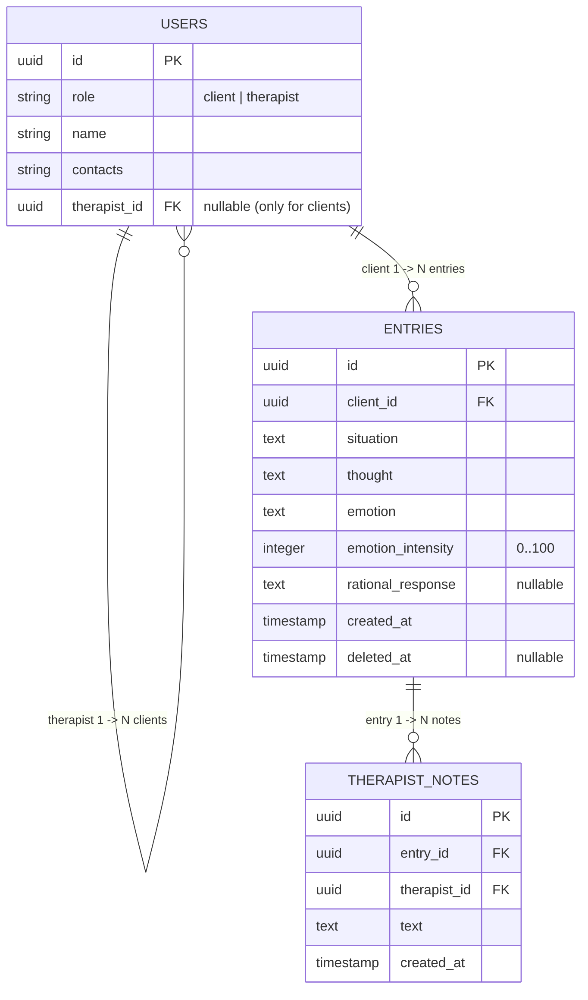

# **CBT Journal**

## **1. Про що застосунок**

Це спрощений журнал когнітивно-поведінкової терапії, який надає клієнту цифровий нотатник думок під рукою замість паперових носіїв для швидкої фіксації стану безпосередньо в момент тригера.

Користувачі системи: Клієнти та їхні особисті Терапевти.

## **2. Ролі та права доступу**

### **Клієнт**

Може:

- Створювати записи в щоденнику.
- Переглядати свої активні записи.
- Видаляти власні записи (м'яке видалення / soft delete).
- Переглядати ім'я та контактні дані свого терапевта.

Не може:

- Редагувати вже створені записи.
- Переглядати нотатки терапевта.
- Переглядати записи інших клієнтів.

### **Терапевт**

Може:

- Переглядати список прикріплених до себе клієнтів.
- Переглядати записи клієнтів.
- Створювати та переглядати приватні нотатки до записів клієнтів (видно лише терапевту).

Не може:

- Редагувати або видаляти записи клієнтів.
- Переглядати клієнтів інших терапевтів та їхні записи.
- Переглядати текст видалених клієнтом записів (лише статус видалення).

## **3. Модулі системи**

| Модуль | Опис функціональності | Користувачі |
|--------|-----------------------|-------------|
| Користувачі (Users) | Збереження профілів користувачів, їхніх ролей (client, therapist), контактної інформації та прив'язки клієнта до конкретного терапевта. | Терапевти, Клієнти |
| Записи щоденника (Entries) | Створення, зберігання та відображення записів КПТ-журналу (ситуація, думки, емоції, інтенсивність, раціональна відповідь). | Клієнти (створення/перегляд/видалення), Терапевти (перегляд) |
| Нотатки терапевта (Therapist Notes) | Створення та зберігання приватних коментарів і спостережень терапевта, прив'язаних до конкретних записів клієнтів. | Терапевти (створення/перегляд) |

## **4. Бізнес-правила**

- **Інтенсивність емоції:** задається цілим числом у діапазоні від 0 до 100 включно.

- **Обов'язковість полів запису:**
  - Обов'язкові: `situation` (ситуація), `thought` (автоматична думка), `emotion` (назва емоції), `emotion_intensity` (інтенсивність).
  - Необов'язкові: `rational_response` (раціональна відповідь). Це дозволяє зберегти запис негайно у момент тригера, а аналіз виконати пізніше.

- **Механізм видалення (Soft Delete):**
  - При видаленні запису клієнтом встановлюється мітка `deleted_at`. Запис фізично не стирається з БД.
  - Клієнт повністю втрачає доступ до видаленого запису (він відсутній у списках клієнта).
  - Терапевт бачить лише статус «запис видалено» — початковий текст ситуації, думки та емоції ховається.

- **Незмінність записів:** записи щоденника після створення не підлягають редагуванню для збереження автентичності первинних емоцій.

- **Прив'язка клієнта:** кожен клієнт має рівно одного закріпленого терапевта (`therapist_id`).

## **5. ER-діаграма та структура даних**

### Таблиці та типи даних

#### `users`

| Поле | Тип / обмеження |
|------|-----------------|
| `id` | UUID / Primary Key |
| `role` | VARCHAR (значення: `'client'`, `'therapist'`) |
| `name` | VARCHAR / NOT NULL |
| `contacts` | TEXT / NOT NULL |
| `therapist_id` | UUID / Foreign Key (`users.id`), Nullable (заповнюється лише для клієнтів) |

#### `entries`

| Поле | Тип / обмеження |
|------|-----------------|
| `id` | UUID / Primary Key |
| `client_id` | UUID / Foreign Key (`users.id`) / NOT NULL |
| `situation` | TEXT / NOT NULL |
| `thought` | TEXT / NOT NULL |
| `emotion` | VARCHAR / NOT NULL |
| `emotion_intensity` | INTEGER / NOT NULL (CHECK `emotion_intensity BETWEEN 0 AND 100`) |
| `rational_response` | TEXT / NULLABLE |
| `created_at` | TIMESTAMP WITH TIME ZONE / DEFAULT NOW() |
| `deleted_at` | TIMESTAMP WITH TIME ZONE / NULLABLE |

#### `therapist_notes`

| Поле | Тип / обмеження |
|------|-----------------|
| `id` | UUID / Primary Key |
| `entry_id` | UUID / Foreign Key (`entries.id`) / NOT NULL |
| `therapist_id` | UUID / Foreign Key (`users.id`) / NOT NULL |
| `text` | TEXT / NOT NULL |
| `created_at` | TIMESTAMP WITH TIME ZONE / DEFAULT NOW() |

## **6. Межі проекту (Out of Scope)**

До поточного проекту не входять і не розробляються такі елементи:

- Повноцінна авторизація та аутентифікація (передачі токенів/паролів немає; поточний користувач передається через HTTP-заголовок `X-User-Id`).
- Вбудований чат або обмін повідомленнями між терапевтом та клієнтом.
- Модуль оплати, білінгу та підписок.
- Мобільний клієнт чи фронтенд-інтерфейс (розробка обмежена Backend REST API).
- Модуль призначення та перевірки домашніх завдань.

## **7. Прийняті технічні рішення та крайні випадки (Edge Cases)**

- **Доля нотаток терапевта при видаленні запису клієнтом:**
  при видаленні запису клієнтом створені нотатки терапевта залишаються видимими для терапевта. Терапевт продовжує бачити свої нотатки у прив'язці до факту запису, який має мітку «запис видалено клієнтом».

- **Кількість емоцій на запис:**
  в межах одного запису фіксується рівно одна емоція (`emotion` + `emotion_intensity`) для спрощення структури та бізнес-логіки.

- **Джерело даних користувачів:**
  оскільки реєстрація відсутня, початкові терапевти та клієнти створюються за допомогою сидингу даних (database seed) під час ініціалізації БД.

- **Безпека та доступ до чужих ресурсів:**
  якщо терапевт намагається отримати доступ до даних клієнта, який закріплений за іншим терапевтом, або до запису чужого клієнта, система повертає HTTP-відповідь `404 Not Found` (замість `403 Forbidden`) для запобігання скануванню та витоку інформації про існування чужих ресурсів.
